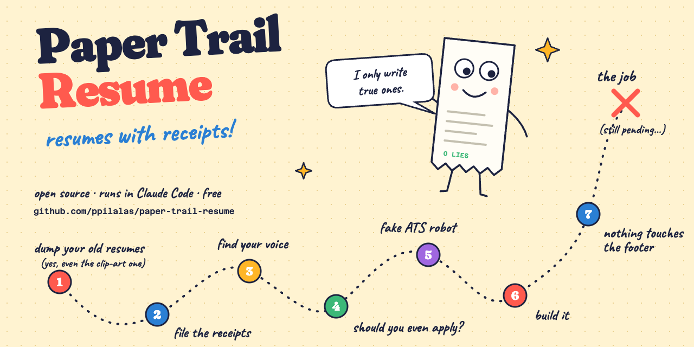

# Paper Trail Resume



*Resumes with receipts.* Every line traces back to something you actually
did, and the result is two pages an applicant tracking system can read and a
human might even enjoy.

A designed, two-page resume system built from HTML and CSS and rendered to a
tagged, ATS-readable PDF. It is made to be driven by an AI coding agent (Claude
Code, Codex, and similar) working from one canonical file of verified career
evidence, with guardrails that keep every claim honest and every page clean.

- **Job Fit Preflight.** Before anything is written, the agent compares the
  job description with your evidence and recommends `Pursue`,
  `Pursue with material gaps`, or `Skip`.
- **Evidence-only content.** Every title, date, tool, and metric must come
  from your data store. Nothing is invented to mirror a posting.
- **Brand accent.** The accent color comes from the target company's brand,
  adjusted only in lightness until it is legible (`npm run accent`).
- **Layout QA gate.** The renderer refuses to write a PDF when text collides
  with the folio, spills past a page edge, or the document is not exactly two
  US Letter pages.
- **Validator.** Checks page count and size, tagging, links, metadata, file
  naming, and that your contact details survive text extraction.
- **ATS simulator.** A read-only agent (`.claude/agents/ats-simulator.md`)
  that reports how applicant tracking systems are likely to parse and rank
  the result.

## Your data stays out of git

The repository holds only the engine, templates, and docs. Everything
personal lives in a **profile** folder that is never committed:

```
profile/                 created for you on first launch; gitignored
  profile.json           name, contact details, filename prefix, folders
  data-store.md          your verified career evidence
  preferences.md         your personal editorial rules
  resumes/               generated HTML sources and briefs/
  output/                final PDFs
```

`profile.example/` holds a complete profile for a fictional candidate, Jordan
Avery, so the system works straight after cloning.

A pre-commit hook (`engine/leak_check.js`) reads your profile and blocks any
commit that contains your name, email, phone, LinkedIn, portfolio, location,
or any extra terms you list under `leakGuard.terms` in `profile.json`, such as
past employers. It also blocks anything under `profile/` and rendered PDFs or
images. If [gitleaks](https://github.com/gitleaks/gitleaks) is installed, the
hook runs it too. Check the whole tree at any time with `npm run leak-check`.

## Setup

Requirements: Node 18+, Python 3.9+, Google Chrome (or Playwright's Chromium),
and `pdftoppm` from poppler for page images (`brew install poppler`).

```bash
git clone <repo-url> ~/Developer/paper-trail-resume   # URL from GitHub's green Code button
cd ~/Developer/paper-trail-resume
npm install                       # also enables the pre-commit hook
python3 -m venv .venv && .venv/bin/pip install -r requirements.txt
```

## Open it in Claude Code

Open the repository folder itself, not a folder above it, so Claude Code
loads `CLAUDE.md` and the startup check in `.claude/settings.json`.

**Desktop app:** open the Claude app, switch to the **Code** tab, start a new
session, and choose `~/Developer/paper-trail-resume` as the folder.

**Terminal:**

```bash
cd ~/Developer/paper-trail-resume && claude
```

Or open it with your first message already sent:

```bash
cd ~/Developer/paper-trail-resume && claude "Help me set up my resume profile"
```

**VS Code:** open the folder (`code ~/Developer/paper-trail-resume`) and start
Claude Code from the Claude icon in the sidebar.

The first time, Claude Code asks whether you trust the folder. Say yes, or
the startup check cannot run.

When a session opens, a one-line message suggests what to type next, based on
how far setup has gone. For example:

| Where you are | Startup message |
|---|---|
| Brand new | New here? Type: "Help me set up my resume profile" |
| Profile created, no documents yet | Resume setup 1/7. Add your past resumes to the intake/ folder in your profile, then type: "I've added my documents" |
| Data store needs review | Resume setup 5/7. Type: "Let's review my data store" |
| Setup finished | Resume profile ready. Paste a job description, or type: "Tailor my resume for this job: \<link\>" |

Claude also gets the full checklist, so it picks up at the next unfinished
step instead of writing a resume. To start again later, open the same folder
the same way; your progress is saved in your profile. Run `npm run status`
yourself at any time to see the same checklist.

## What setup looks like

The agent walks you through these steps before it will write anything:

1. **Your private profile appears on its own.** The first session creates
   `profile/` inside the folder you opened. There's nothing to choose.
2. **Add your documents to `profile/intake/`.** Required: your past resumes,
   as many versions as you have. Recommended: a LinkedIn profile PDF, cover
   letters, performance reviews, or a brag document. The agent lists what it
   found, points out gaps such as missing years, and keeps asking until you
   say that's everything. You can also paste text or drop files into the
   chat, and it saves them to `intake/` for you.
3. **It builds your data store.** It extracts text (`npm run extract`), fills
   `profile.json`, and writes `data-store.md` with every fact cited to its
   source document.
4. **You review it together.** It walks you through conflicts between resume
   versions and any metric whose scope is unclear.
5. **A short preferences interview** covers voice, what to leave out, and your
   favorite results, and the answers go into `preferences.md`.

After that, paste a job description. The agent follows `AGENTS.md`:
preflight, your decision, brief, brand accent, draft, render, validate, and
visual review.

Full script: [`docs/ONBOARDING.md`](docs/ONBOARDING.md). To see the system
working before you add anything, point it at the fictional example profile:

```bash
export RESUME_PROFILE_DIR="$PWD/profile.example"
npm run new -- --company 'Contoso' --role 'Head of Growth' --date '2026-07-28'
npm run render -- --input profile.example/resumes/Contoso-Head-of-Growth.html \
  --output profile.example/output/Jordan-Avery-Resume-Contoso-Head-of-Growth-2026-07-28.pdf
npm run validate -- profile.example/output/Jordan-Avery-Resume-Contoso-Head-of-Growth-2026-07-28.pdf \
  --expect 'Head of Growth' --qa-dir qa/contoso
```

## Commands

| Command | What it does |
|---|---|
| `npm run init` | Create the private profile by hand (normally automatic) |
| `npm run status` | Onboarding checklist and the next step |
| `npm run extract` | Convert intake documents to text for the agent |
| `npm run new` | Scaffold a resume and brief for one job |
| `npm run render` | Render HTML to PDF through the layout QA gate |
| `npm run validate` | Check the PDF and create page images for review |
| `npm run accent` | Turn brand colors into a legible accent |
| `npm run profile` | Show the resolved profile and paths |
| `npm run leak-check` | Scan the repo for your personal data |

With an AI agent, open the repository and ask for a resume for a job
description. The agent follows `AGENTS.md`: preflight, your decision, brief,
brand accent, draft, render, validate, visual review.

## Repository layout

| Path | Purpose |
|---|---|
| `AGENTS.md` | Rules every agent follows (`CLAUDE.md` imports it) |
| `docs/ONBOARDING.md` | First-run walkthrough the agent follows until setup is complete |
| `docs/WORKFLOW.md` | Step-by-step process, commands, and QA checklist |
| `docs/DESIGN-PRINCIPLES.md` | Creative standard, anti-slop and JD-mirroring reviews |
| `templates/starter.html` | Production starter with `{{TOKENS}}` filled from your profile |
| `templates/PROJECT-BRIEF-TEMPLATE.md` | Per-resume brief |
| `engine/` | Onboarding status, intake extraction, profile loader, scaffolder, renderer, layout gate, validator, accent resolver, leak check |
| `profile.example/` | Fictional sample profile |
| `.claude/agents/ats-simulator.md` | ATS simulation agent |

## License

MIT
